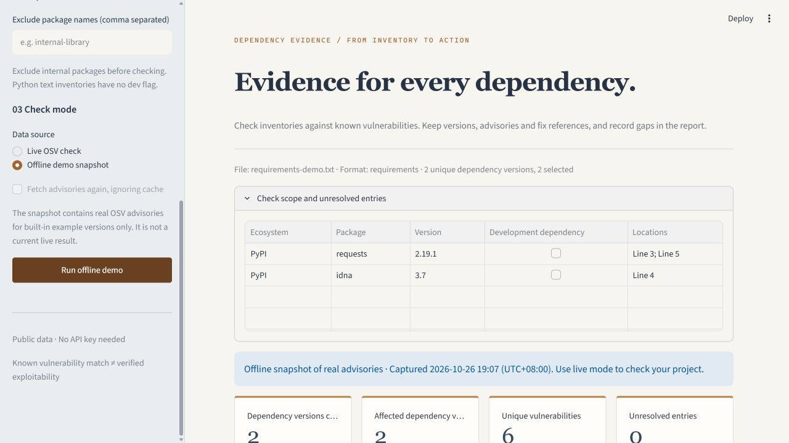

# ◉ Dependency Evidence Workbench

**English** | [简体中文](README.zh-CN.md)

Turn Python / npm dependency inventories into reviewable, exportable vulnerability evidence reports.

[](https://github.com/LINXsoserious/dependency-evidence-workbench/actions/workflows/tests.yml)



[Chinese interface screenshot](docs/screenshot.png)

Use the web interface for inspection and the CLI for daily checks or CI. No model, API key or payment card is required. Dependencies listed in an inventory are never installed, imported or executed.

## What it does

1. Import pinned requirements, pip list JSON or npm package-lock v2/v3, then preview the check scope.
2. Explicitly start a live check against [OSV](https://osv.dev/) using each package's ecosystem, name and exact version.
3. Merge GHSA / PYSEC / CVE aliases while retaining each affected dependency version and original advisory identifier.
4. Filter by package, CVE, keyword and severity; inspect original advisory excerpts, fixed-version boundaries and source links.
5. Export Markdown, JSON or CSV, including unresolved entries, failed queries and unavailable advisory details.

**No match, unresolved input, query failure and withdrawn-only matches are distinct outcomes. Failed requests are never reported as zero vulnerabilities.**

## Quick start

Requires Python 3.11+. From the project directory:

```powershell
python -m venv .venv
& .\.venv\Scripts\python.exe -m pip install -r requirements.txt
& .\.venv\Scripts\python.exe -m streamlit run app.py
```

On Windows, `./run.ps1` also creates a project virtual environment and installs dependencies on its first run.

macOS / Linux:

```bash
python3 -m venv .venv
. .venv/bin/activate
python -m pip install -r requirements.txt
python -m streamlit run app.py
```

Installing dependencies requires network access. The built-in demo reads a previously captured snapshot of real advisories and works offline. Live mode queries OSV only after you click the check button.

## Language settings

Choose **English** or **简体中文** in the sidebar's **Language / 界面语言** control. Chinese remains the default. Switching localizes application-owned headings, controls, status messages and newly downloaded Markdown / CSV reports. It retains the selected example, pasted inventory, scope, filters, selected evidence and current results, without making another request.

The CLI accepts `--lang en` or `--lang zh` for help, errors and readable reports; the default is `zh`. JSON fields and values, package names, versions, vulnerability identifiers, original advisory text and reference links stay unchanged. Technical details returned by the operating system or third-party parsers retain their original wording. Translation uses explicit local dictionaries and no translation service. Unsupported locale codes in the Python export functions deterministically fall back to Chinese.

## Check your own project

### Python

Upload a requirements.txt file containing exact pinned versions. Constraints such as `requests>=2` are not silently resolved to an invented version.

To check packages actually installed in an environment, export from **the target project's environment**:

```bash
python -m pip list --format=json > installed.json
```

Then upload installed.json. Requirements checks cover only dependencies listed in the file and do not resolve transitive dependencies; pip list reflects packages installed in the exported environment. Conditional markers are recorded, but their activation in the target environment is not inferred.

### JavaScript / TypeScript

Upload npm-generated package-lock.json v2/v3. The check includes recorded dependencies and nested versions, with an option to exclude entries marked dev. package.json version ranges and lock v1 are unsupported in this release.

### Command line

```bash
python -m dependency_workbench.cli requirements.txt --lang en --format markdown --output report.md
python -m dependency_workbench.cli installed.json --format json --output report.json
python -m dependency_workbench.cli package-lock.json --production --exclude internal-library --output report.json
python -m dependency_workbench.cli --demo --lang en --format markdown
python -m dependency_workbench.cli --lang zh --help
```

Exit codes:

| Code | Meaning |
| --- | --- |
| `0` | The selected scope was checked completely, with no active public vulnerability records matched |
| `1` | The selected scope was checked completely, with public vulnerability records matched |
| `2` | Input, parsing, queries or details are incomplete, or no versions can be checked |

The demo intentionally matches vulnerabilities in historical versions, so exit code 1 is expected. Versions absent from the snapshot produce an incomplete result; offline mode does not pretend to scan arbitrary packages. Existing output files are never overwritten. Choose a new filename to retain multiple reports.

## Read fix references correctly

“Advisory fixed versions” comes from OSV affected entries for the matched package. Only fixed events from SEMVER / ECOSYSTEM ranges are extracted; versions belonging to another package and Git commit hashes are not treated as upgrade versions.

A vulnerability may affect multiple maintenance branches, with boundaries such as `0.2.4` and `1.2.6`. These are advisory facts, **not automatically chosen upgrade targets**. Select an upgrade using your current branch, compatibility requirements and advisory conditions. The program does not modify inventories or verify vulnerability reachability, exploitability or deployment state.

## Real examples and verification

- Built-in examples originate from the real OSV API and include a capture timestamp. The retained snapshot contains 5 dependency versions and 18 original advisory records.
- Python example: 2 unique dependency versions and 6 vulnerability groups after alias merging.
- npm example: 3 unique dependency versions, 2 affected versions and 6 merged vulnerability groups.
- The mixed inventory deliberately includes 2 declarations without exact pins and yields an incomplete result.
- [Recorded live check of this tool's environment](docs/evidence/installed-environment-report.json): public-record matching for 35 installed packages; see the file for time and scope.
- [Verification record (Chinese)](docs/verification.md) distinguishes automated tests, actual API calls and browser checks.

These counts describe a fixed snapshot and a specified environment. They do not measure tool accuracy or establish the security of a real project.

## Data and privacy

Live queries send selected **package names, ecosystems and exact versions** to `https://api.osv.dev`, without uploading the inventory file. Exclude internal packages in the UI or CLI before checking. Uploaded and pasted content remains in the current application session and is not automatically saved to disk. Reports are written when you download them or explicitly use `--output`.

Public advisory details may be cached in `.cache/osv` for up to 24 hours by default; version matching still uses a live query. The cache contains public advisories only, without inventories, query results or credentials. The refresh checkbox or `--refresh` ignores the advisory cache. If publicly hosted, uploaded files are sent to the Streamlit server running the application, rather than remaining only in the browser.

Limits: 5 MB of input, 50,000 entries and 2,000 unique dependency versions. Queries use batches, per-item pagination, request timeouts and bounded retries. Each check reads at most 200 advisory details. Reaching pagination, time or detail limits retains matches and marks the result incomplete; truncation is never silently presented as a complete check.

## Tests and project structure

```bash
python -m unittest discover -s tests -v
```

CI runs the same suite on Ubuntu and Windows with Python 3.12. Tests use fixed snapshots and controlled responses, without relying on live OSV availability.

The v0.2.0 regressions cover dictionary key parity, a complete English offline flow, input / scope / evidence / result retention after language switches, explicit live-check clicks, localized CLI help and errors, stable JSON, and exit codes `0/1/2`. Public Python exports remain compatible: use `markdown_report(report, lang="en")` or `csv_report(report, lang="en")`; omitting `lang` keeps Chinese output. `scan` continues returning the stable original JSON record.

```text
app.py                         Web interface
dependency_workbench/
  manifests.py                 Inventory parsing and scope
  osv.py                       OSV queries, pagination, errors and advisory cache
  report.py                    Alias merging, fix evidence and exports
  cli.py                       Command line and exit codes
  i18n.py                      Local text dictionaries and diagnostic display
samples/                       Example inventories and real advisory snapshot
scripts/refresh_demo.py         Explicit public example-data refresh
tests/                         Behavior and interface tests
docs/                          Verification, screenshots and recorded reports
```

## Sources and license

Code is licensed under Apache-2.0. The advisory snapshot comes from the GitHub Advisory Database and PyPA Advisory Database as aggregated by OSV. Source attribution is retained under CC BY 4.0; see [DATA_SOURCES.md](DATA_SOURCES.md) and [the data license](LICENSES/CC-BY-4.0.txt).

This is an independent, lightweight implementation using a public API, intended for explicit inventory checks and evidence organization. Coverage is limited to the supported formats and ecosystems. Initial code, tests and documentation were produced and verified with AI assistance; the user's independent mastery requires subsequent practical use and modification. This release includes no large language model or autonomous agent.
