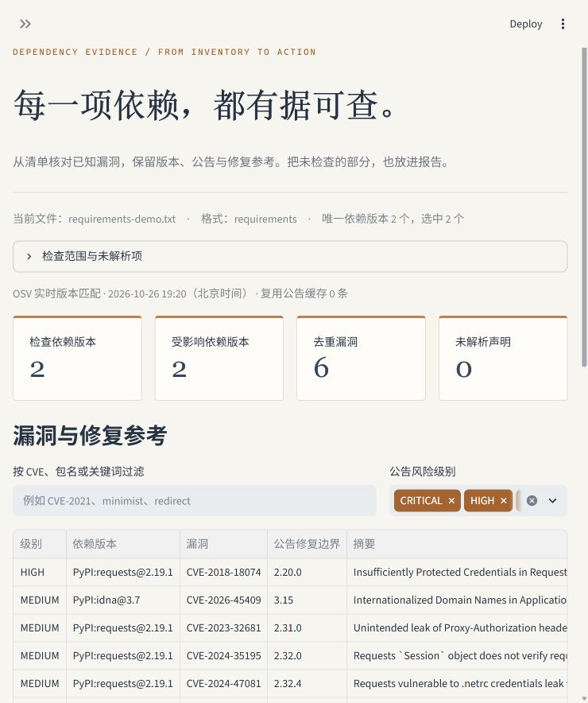

# ◉ 依赖漏洞核验工作台

[English](README.md) | **简体中文**

**Dependency Evidence Workbench** — 把 Python / npm 依赖清单，变成可复查、可导出的漏洞证据报告。

[](https://github.com/LINXsoserious/dependency-evidence-workbench/actions/workflows/tests.yml)



网页适合人工查看，CLI 适合日常检查和 CI。无需模型、API 密钥或银行卡；不安装、导入或执行清单中的依赖。

## 能做什么

1. 导入 requirements 精确版本、pip list JSON、npm package-lock v2/v3，先查看检查范围。
2. 点击联网检查，由 [OSV](https://osv.dev/) 按生态、包名和版本匹配已知漏洞。
3. 合并 GHSA / PYSEC / CVE 等别名；保留各个受影响的依赖版本与原始来源编号。
4. 筛选包名、CVE、关键词和级别，查看公告摘录、修复边界及来源链接。
5. 下载 Markdown、JSON 或 CSV。解析失败、查询失败和未取得详情会写进报告。

**“未命中”“未解析”“查询失败”“仅命中撤回公告”分别展示。不会把请求失败写成零漏洞。**

## 快速运行

需要 Python 3.11+。在项目目录中：

```powershell
python -m venv .venv
& .\.venv\Scripts\python.exe -m pip install -r requirements.txt
& .\.venv\Scripts\python.exe -m streamlit run app.py
```

Windows 也可运行 `./run.ps1`，首次创建项目虚拟环境并安装依赖。

macOS / Linux：

```bash
python3 -m venv .venv
. .venv/bin/activate
python -m pip install -r requirements.txt
python -m streamlit run app.py
```

安装依赖需要联网。内置演示读取已获取的真实公告快照，不需要网络；联网模式只在用户点击后查询 OSV。

## 语言设置

网页侧栏的“界面语言 / Language”可选择“简体中文”或“English”，默认中文。切换会翻译程序自有标题、控件、状态和提示，以及新下载的 Markdown / CSV 报告；保留已选样例、粘贴清单、检查范围、筛选、所选证据和现有检查结果，不会触发新请求。

CLI 使用 `--lang en` 或 `--lang zh` 选择帮助、错误和可读报告的语言，默认 `zh`。JSON 字段和值、包名、版本、漏洞编号、原始公告与引用链接不随语言改变。系统或第三方解析器返回的技术错误明细保留原文。翻译使用本地显式字典，不调用翻译服务；不支持的 Python 导出语言代码固定回退中文。

## 用在自己的项目上

### Python

上传精确锁定版本的 requirements.txt。范围约束如 `requests>=2` 不会被擅自解析为某个版本。

要检查当前环境实际安装的包，先在**目标项目的环境中**导出：

```bash
python -m pip list --format=json > installed.json
```

然后上传 installed.json。requirements 只检查文件实际列出的依赖，不自动补全传递依赖；pip list 则反映导出环境中的已安装包。条件标记会保留说明，但不推断目标环境是否启用。

### JavaScript / TypeScript

上传 npm 生成的 package-lock.json v2/v3。检查其记录的依赖，包括嵌套版本；可选择排除标为 dev 的开发依赖。package.json 范围声明和旧版 lock v1 不在本版支持范围。

### 命令行

```bash
python -m dependency_workbench.cli requirements.txt --lang zh --format markdown --output report.md
python -m dependency_workbench.cli installed.json --format json --output report.json
python -m dependency_workbench.cli package-lock.json --production --exclude internal-library --output report.json
python -m dependency_workbench.cli --demo --format markdown
python -m dependency_workbench.cli --demo --lang en --format markdown
python -m dependency_workbench.cli --lang en --help
```

退出码：

| 退出码 | 含义 |
| --- | --- |
| `0` | 在选定范围内完成查询，未匹配到有效公开漏洞记录 |
| `1` | 在选定范围内完成查询，匹配到公开漏洞记录 |
| `2` | 输入 / 解析 / 查询 / 详情不完整，或没有可检查的版本 |

`--demo` 默认有意命中历史版本漏洞，退出码 1 是预期结果。快照不覆盖的版本会返回不完整结果，不会假装做了离线通用扫描。指定的输出文件若已存在则拒绝覆盖；更换文件名即可保留多次检查记录。

## 修复参考怎么读

“公告修复边界”来自与当前包对应的 OSV 受影响条目，只提取 SEMVER / ECOSYSTEM 的 fixed 事件，不把其他包或 Git 提交哈希当成版本。

同一漏洞可能有多个维护分支，例如 `0.2.4` 和 `1.2.6`。这里列出的是公告事实，**不是自动选出的升级目标**；仍需根据当前分支、兼容性和公告条件选择。程序不修改清单，不验证漏洞可达性、利用条件或实际部署状态。

## 真实示例与验证

- 内置示例来自真实 OSV API，快照带获取时间；当前快照含 5 个依赖版本、18 条原始公告记录。
- Python 示例：2 个唯一依赖版本，合并别名后 6 组漏洞。
- npm 示例：3 个唯一依赖版本，其中 2 个命中，合并后 6 组漏洞。
- 混合清单示例刻意包含 2 条无法锁定的声明，报告为不完整。
- [本工具环境的实际联网检查](docs/evidence/installed-environment-report.json)：35 个已安装包的公开记录匹配，检查时间及范围见文件。
- [验证记录](docs/verification.md)区分自动化测试、真实 API 调用和浏览器检查。

这些数字是固定快照与指定环境的结果，不是工具准确率或现实项目安全保证。

## 数据与隐私

联网查询向 `https://api.osv.dev` 发送选中的**包名、生态和精确版本**，不上传清单原文。内部包可先在界面或 CLI 中排除。上传、粘贴内容保存在当前应用会话，不自动写入磁盘；用户明确下载或使用 `--output` 时才生成报告。

公告详情可缓存在项目 `.cache/osv`，默认最长 24 小时；版本匹配仍实时查询。缓存只有公开公告，不包含清单、查询结果与凭据。选择“重新获取公告”或 `--refresh` 可忽略缓存。若公开部署，文件会发送到运行 Streamlit 的服务器，而不是只留在浏览器里。

输入最多 5 MB、50,000 条记录、2,000 个唯一依赖版本。查询按批分组、逐项分页，单请求有超时及有限重试。每次最多读取 200 个公告详情，达到分页 / 时间 / 详情上限会保留命中并标明不完整。不会静默截断后宣称检查完成。

## 测试与项目结构

```bash
python -m unittest discover -s tests -v
```

CI 在 Ubuntu 与 Windows / Python 3.12 上运行相同测试。测试只使用固定快照和可控响应，不依赖实时 OSV 网络状态。

v0.2.0 增加字典键一致、英文完整离线流程、切换语言后输入 / 范围 / 证据 / 结果保持、联网检查必须显式点击、双语言 CLI 帮助与错误、JSON 稳定和退出码 `0/1/2` 回归。公开 Python 导出兼容旧调用：`markdown_report(report, lang="en")`、`csv_report(report, lang="en")`，省略 `lang` 仍为中文；`scan` 继续返回稳定的原始 JSON 记录。

```text
app.py                         网页
dependency_workbench/
  manifests.py                 清单解析与范围
  osv.py                       OSV 查询、分页、错误与公告缓存
  report.py                    去重、修复证据与导出
  cli.py                       命令行及退出码
  i18n.py                      本地文案字典与诊断显示翻译
samples/                       清单示例、真实公告快照
scripts/refresh_demo.py         显式更新公开示例数据
tests/                         行为与界面测试
docs/                          验证记录、截图与实际报告
```

## 来源与许可

程序代码采用 Apache-2.0。公告快照来自 OSV 汇集的 GitHub Advisory Database 和 PyPA Advisory Database，按 CC BY 4.0 保留来源，详见 [DATA_SOURCES.md](DATA_SOURCES.md) 与 `LICENSES/CC-BY-4.0.txt`。

这是基于公开 API 的独立轻量实现，适合显式清单检查与证据整理；并非全生态扫描器。首次代码、测试和文档由 AI 辅助制作并核验，用户本人掌握情况需通过后续实际修改与使用确认。本版不包含大模型或自主 Agent。
